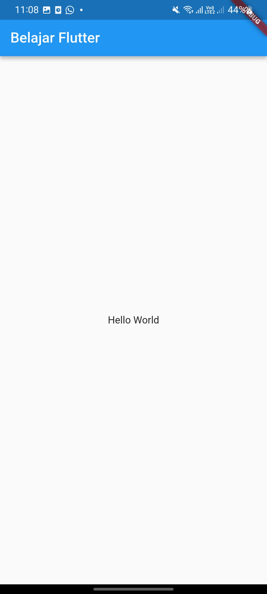
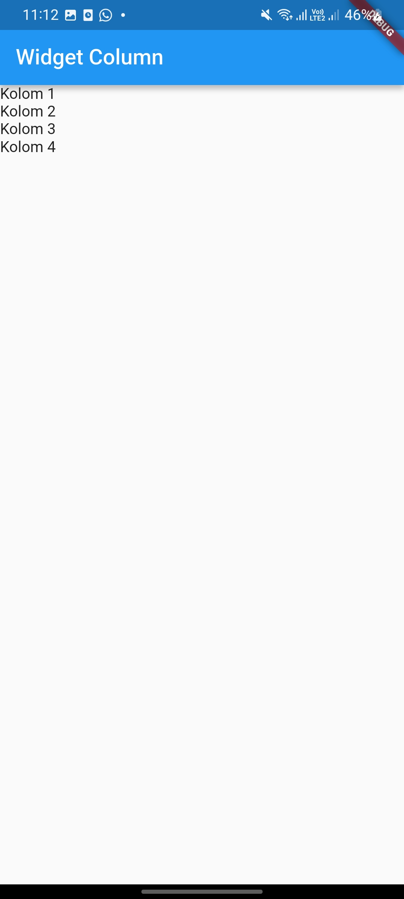
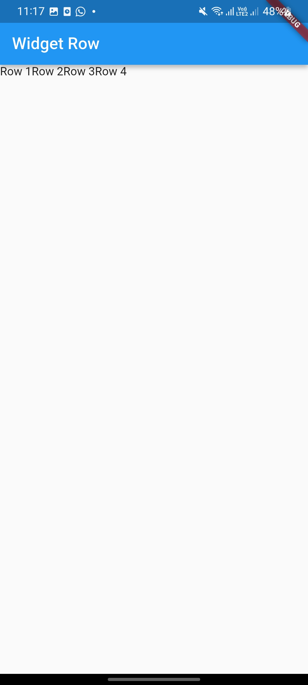
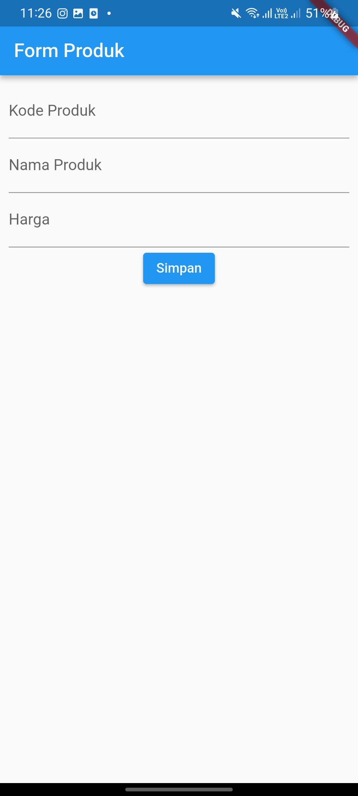
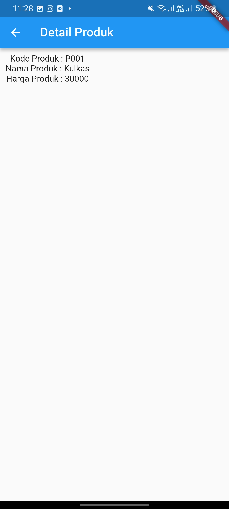
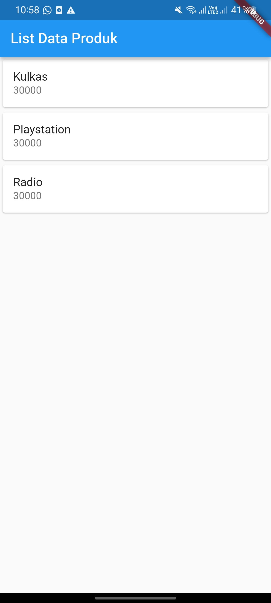

# Praktikum Pemrograman Mobile - Modul 2
## Pengenalan dan Desain Framework Flutter

---

### Identitas Mahasiswa
- **Nama** : Salsabila Firzah Amanina
- **NIM** : H1D024069
- **Shift Awal** : H
- **Shift Akhir** : D

---

### 1. Dasar Widget (Hello World, Column, & Row)

Penjelasan singkat:
- **Hello World**: Menampilkan widget dasar `MaterialApp`, `Scaffold`, `AppBar`, `Center`, dan `Text` sebagai awalan framework Flutter.
- **Column Widget**: Mengatur tata letak child widget secara vertikal (ke bawah).
- **Row Widget**: Mengatur tata letak child widget secara horizontal (ke samping).

| Hello World | Column Widget | Row Widget |
| :---: | :---: | :---: |
|  |  |  |

---

### 2. Form Input, Navigasi Halaman, & ListView

Penjelasan singkat:
- **Form Produk**: Menggunakan `TextField` untuk menginput Kode Produk, Nama Produk, dan Harga, serta tombol `Simpan` untuk mengirim data ke halaman lain.
- **Detail Produk**: Menampilkan detail data yang dikirim dan diterima dari form input sebelumnya.
- **List Data Produk**: Menampilkan daftar katalog produk menggunakan widget `ListView` bertipe `Card` secara dinamis.

| Form Produk | Detail Produk | List Data Produk |
| :---: | :---: | :---: |
|  |  |  |
